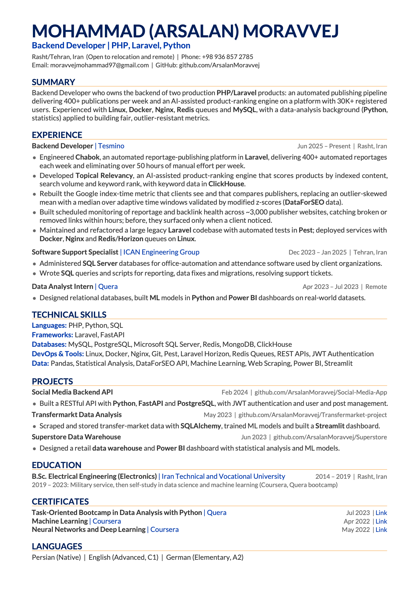

# My Résumé / CV

This is a repository for sharing my Résumé. It's written in LaTeX as an ATS-friendly, single-column layout: the standard `article` class with the Lato font and plain, machine-readable text, so applicant tracking systems can parse it correctly.

- `main.tex`: source of my Résumé
- `CV_Mohammad_Moravvej.pdf`: compiled PDF
- `Template/`: an empty version with placeholders that you can fill in with your own details

## Build

Compile with `pdflatex`:

```bash
pdflatex main.tex
```

Or upload `main.tex` to [Overleaf](https://www.overleaf.com/) and click **Recompile**. Overleaf already has every package this needs.

To make your own Résumé, clone this repository and edit `Template/main.tex`.


