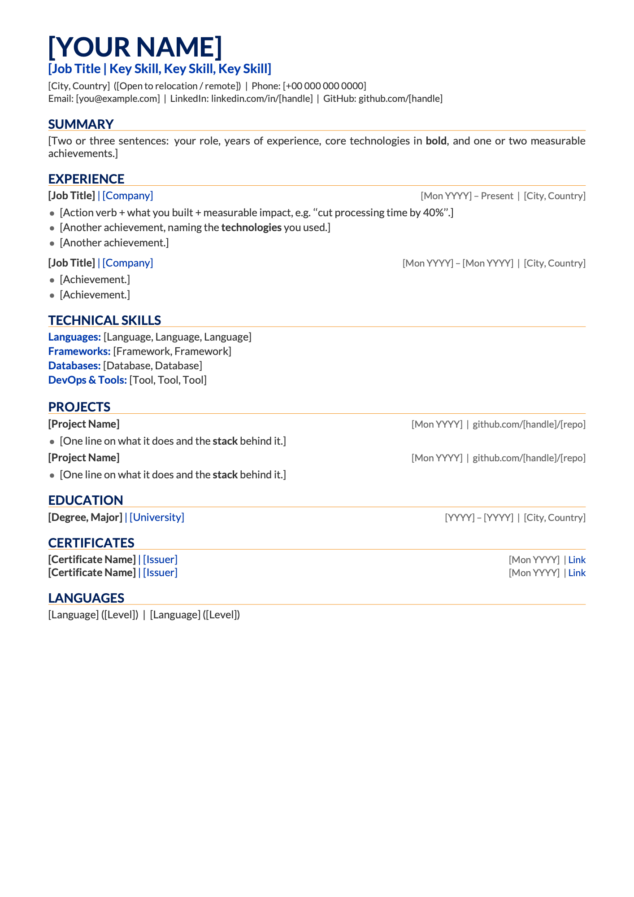

# Template

An empty, ATS-friendly single-column Résumé template (file `main.tex`). It uses the standard `article` class with the Lato font, so it needs no custom `.cls` file.

To use it, replace every `[ ... ]` placeholder with your own details and compile with `pdflatex` (or upload `main.tex` to [Overleaf](https://www.overleaf.com/) and click **Recompile**).

